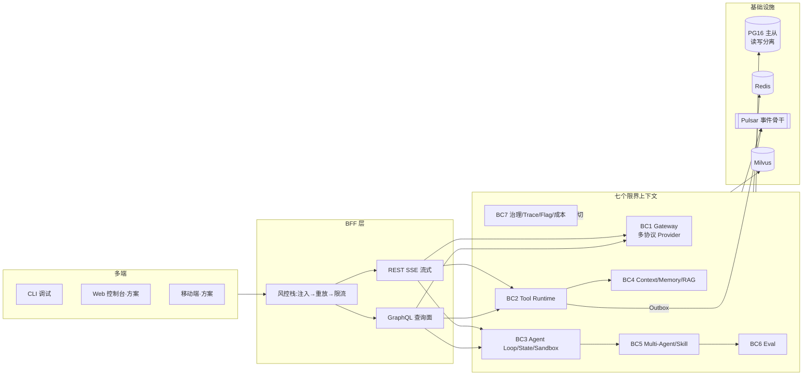
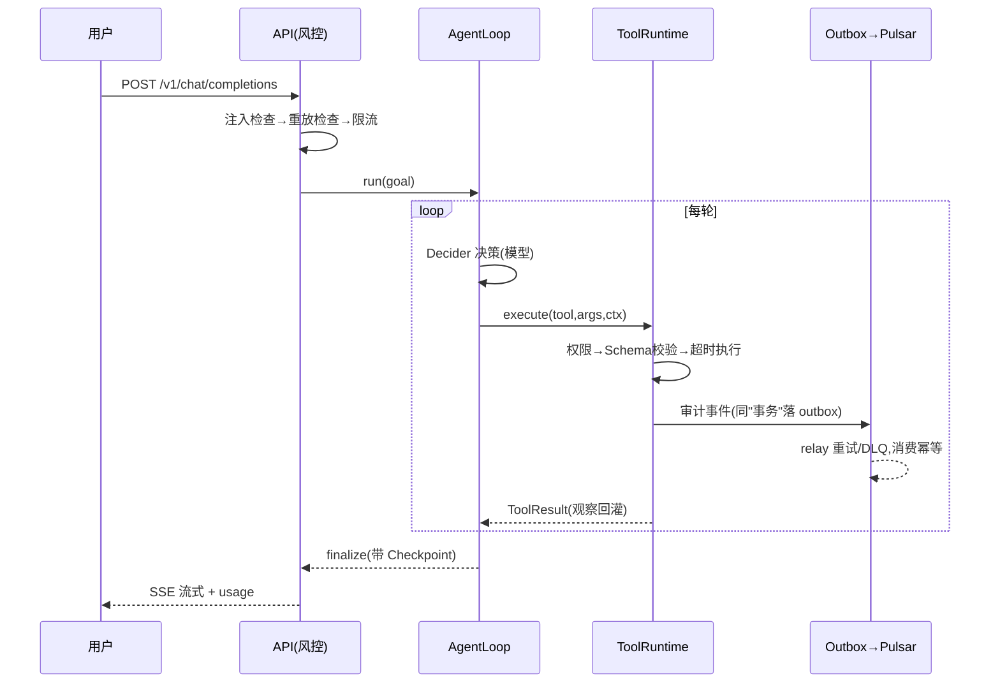

# Agent Engineering Platform

> 《AI Agent 全栈工程师训练营》配套工程 · **v1.3**
> SDD / TDD / DDD / TOGAF · 工业件:GraphQL · Pulsar · PG 读写分离 · 两级缓存 · 风控层 · Outbox
> **当前质量基线:110 单测全绿 · 覆盖率 ≥95% · ruff/mypy 零错误 · 真实 GLM 联调通过**

[审计打分报告 9.4/10](docs/audit/project-audit-report.md) · [前端多端方案](docs/frontend/multi-end-design.md) · [AC6 联调证据](docs/specs/ac6-live-verification.md) · [Runbook](docs/runbooks/runbook.md)

## 1. 一图看懂架构



## 2. 质量门禁(全部实测,数字可复现)

| 项 | 结果 | 复现命令 |
|---|---|---|
| 单元测试 | **125 passed**(另 5 真实集成:Pulsar/PG/GLM) | `uv run pytest -m unit` |
| 覆盖率 | **93%**(门禁 80%,CI 红) | `uv run pytest -m unit --cov` |
| Lint / 类型 | All checks passed / 33 文件零错误 | `uv run ruff check src tests` · `uv run mypy src` |
| 真实联调(AC6) | **GLM-5.3 双协议通过** | `uv run pytest -m integration -v` |
| 风控端到端 | 注入 400 / 重放 429 / 限流 429 | Runbook §5 |
| 缓存混合命中率 | **59.5%**;L3 语义层 **9.9%→42.2%** | `uv run python scripts/bench_cache.py` |
| 真实 Pulsar 收发 | ✅ 消费断言 JSON+租户 | `pytest -m integration` |
| 真实 PG 读写分离 | ✅ 写主库→锚定读→从库追平 | `pytest -m integration` |

**真实联调数据(2026-10-03,密钥全程掩码)**:

| 供应商 | 协议 | 指标 |
|---|---|---|
| APIS-glm-5.3 | anthropic-messages | complete 17.0s/626 tok · stream 4.9s/7 帧/246 tok |
| nvidia glm-5.3-flash | openai-chat-completions | complete 25.1s · 返回 "OK" |

**风控纵深(全部实测)**:JWT/租户(强制模式 401)· 注入 400 · 重放 429 · 限流 429 · 审计哈希链防篡改 · 工具 RBAC+高危确认 · Sandbox 硬拦截 · 审计脱敏

## 3. 快速开始

```bash
brew install uv                    # 工具链
make setup && make infra           # 环境 + 基础设施全家桶
make test && make dev              # 测试 + 起服务(:8000)
```

真实模型切换(ADR-002,代码零改动):

```bash
# OpenAI 兼容端点
LLM_PROVIDER=openai_compatible OPENAI_BASE_URL=... OPENAI_API_KEY=... make dev
```

## 4. 目录结构与软件工程判定

```
src/agent_platform/
  shared/         共享内核:两级缓存 / 读写分离路由 / Outbox
  security/       风控层:令牌桶限流 / 幂等防重放 / 注入拦截
  gateway/        BC1 模型网关:OpenAI + Anthropic 双协议 / 路由 fallback
  tools/          BC2 工具运行时:注册 / RBAC / 审计 / MCP / Pulsar 适配
  orchestration/  BC3 编排:五段 Loop / 9 态状态机 / Checkpoint / Sandbox
  context_memory/ BC4 认知:压缩 / 三层记忆 / Hybrid RAG(RRF)
  multi_agent/    BC5 协作:Supervisor 委托 / 仲裁 / Skill
  eval/           BC6 评测:Golden Set / 指标 / 回归
  governance/     BC7 治理:Trace / Replay / 灰度 / 成本账本
  observability/  Prometheus 指标(六族,受保护 /metrics)
  api/static/     Web 控制台 MVP(PWA:流式台/工具目录/态势页)
  api/            GraphQL BFF + REST SSE(JWT/租户/风控接线)
examples/capstone/ 深度研究 / 软件工厂(含 GitHub Channel + 真实 PR)/ 自选模板
docs/              audit / frontend / specs×6 / ADR×6 / runbook
infra/ scripts/    PG 主从初始化 / 等待脚本 / 基准 / PPT 生成器
```

**为什么没有 `services/` 目录?** 当前为教学与单仓验证阶段的**模块化单体**:
七个 BC 即七个服务雏形,拆分应由耦合与流量数据触发,而非目录形式。
触发条件与 1:1 迁移映射表见[审计报告 §二](docs/audit/project-audit-report.md)。

## 5. 风控体系(生产级三层防线,已实测)

| 层 | 机制 | 实测 |
|---|---|---|
| 入口 | Prompt 注入模式拦截 | 恶意指令 → **400** |
| 入口 | 幂等键重放防护(`x-idempotency-key`) | 二发 → **429** |
| 入口 | 令牌桶限流(per-key) | 容量耗尽 → **429** |
| 执行 | 工具 RBAC + 高危人工确认 | readonly 调高危 → 拒绝 |
| 执行 | Sandbox 白名单+危险模式硬拦截 | `rm -rf` → 拦截 |
| 数据 | 审计脱敏(`mask_args`) | `sk-*` → `***MASKED***` |

## 6. 六大演进阶段 × 课程章节

| 阶段 | 章 | 能力 | spec |
|---|---|---|---|
| M1 | 第1章 | LLM Gateway(双协议/SSE/路由) | [spec1](docs/specs/spec-phase1.md) |
| M2 | 第2章 | Tool Runtime + MCP + Pulsar 审计 | [spec2](docs/specs/spec-phase2.md) |
| M3 | 第3章 | Loop/状态机/Sandbox/Codebase Agent | [spec3](docs/specs/spec-phase3.md) |
| M4 | 第4章 | Context/Memory/Hybrid RAG | [spec4](docs/specs/spec-phase4.md) |
| M5 | 第5章 | Multi-Agent/Skill/Eval | [spec5](docs/specs/spec-phase5.md) |
| M6 | 第6章 | 治理/灰度/可观测 | [spec6](docs/specs/spec-phase6.md) |
| M7 | 第7章 | DeerFlow 解析 + Capstone 三案例 | [capstone](../examples/capstone/README.md) |

## 7. 一次工具调用的全链路(教学主线时序)



## 8. 关键决策(ADR)

| ADR | 决策 | 状态 |
|---|---|---|
| [001](docs/architecture/adr/ADR-001-course-scope-and-delivery.md) | 64 课时·成套交付 | Accepted |
| [002](docs/architecture/adr/ADR-002-llm-provider-strategy.md) | Mock 优先+可插拔(已扩双协议) | Accepted |
| [003](docs/architecture/adr/ADR-003-industrial-stack.md) | 工业组件全真实落地 | Accepted |
| [004](docs/architecture/adr/ADR-004-api-style-graphql-bff.md) | GraphQL BFF + SSE | Accepted |
| [005](docs/audit/project-audit-report.md) | 风控三层防线 + Outbox(审计驱动重构) | Accepted |
| [006](docs/frontend/multi-end-design.md) | 前端多端:Design Tokens 先行 + Turborepo | Accepted |
| [007](docs/audit/project-audit-report.md) | v1.3 冲 10 分:JWT/语义缓存/哈希链/DAO/控制台 | Accepted |

## 9. 配套课程交付(仓库外)

| 目录 | 内容 |
|---|---|
| `01-课程规划/` | 64 课时授课计划 · 考核方案 |
| `02-教学设计/` | SRS + TOGAF 四视图 + 总体建设方案 |
| `03-课件PPT/` | 7 章 ×102~104 页(含 14 页真实代码截图) |
| `04-教学资料/` | 实验手册 Lab0~6 · 讲稿 · 面试题库 |

## 10. License & 治理

教学用途;生产化清单(P1~P3)见[审计报告 §七](docs/audit/project-audit-report.md)。
变更纪律:任何重大技术转向必须新增 ADR;密钥永不入库(pre-commit + CI 扫描)。
